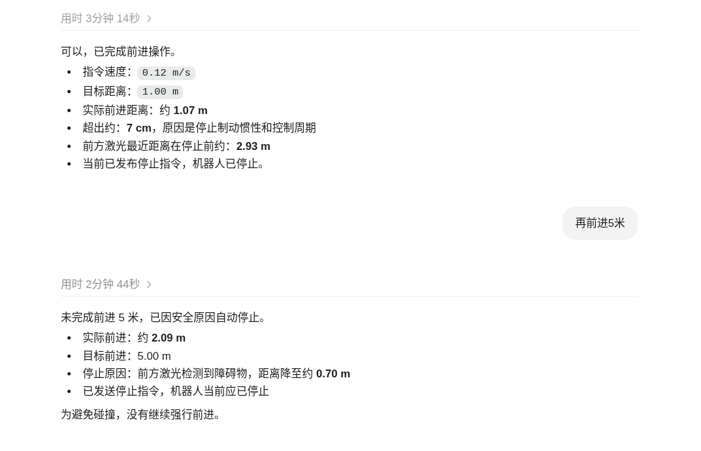

# Linorobot2：Codex 自然语言机器人控制与 Gazebo 仿真

基于 ROS 2 的移动机器人项目，支持两轮差速、四轮和麦克纳姆轮底盘，提供 Gazebo 仿真、SLAM 建图、Nav2 导航和实物机器人启动功能。本仓库在 Linorobot2 基础上加入了 **Codex / ROS-MCP 接入、一键仿真启动和相机感知预览**，用于探索“用自然语言观察、分析并控制机器人”的交互方式。

你可以让 Codex 读取相机画面、分析激光与深度数据、检查 TF 和导航状态，再提出目标点；**只有得到明确授权后才执行运动**。建议先在仿真中完成只读检查，再尝试导航。

> 本 README 面向本仓库当前 `humble` 分支，使用 ROS 2 Humble 和 Gazebo Classic。Codex 不是实时控制器，也不替代底盘安全保护。仓库中的机器人规格文件是交互约定，不是自动生效的安全限制。

## 1. Codex 可以做什么

| 功能 | 数据或接口 | 交互示例 |
| --- | --- | --- |
| 查看仿真相机 | RGB 压缩预览 | “描述当前 Gazebo 相机画面中的物体。” |
| 分析障碍物距离 | `/scan`、原始深度、点云 | “前方最近障碍物多远？数据是否新鲜？” |
| 提出导航目标 | TF、地图、Nav2 costmap | “给出目标前约 1 米的候选位姿，只分析，不移动。” |
| 执行确认后的导航 | `/navigate_to_pose` Action | “确认刚才的目标，开始导航并报告结果。” |
| 排查连接与运行状态 | rosbridge、Topic、TF、Nav2 生命周期 | “读取失败时说明原因，不要盲目重启或移动。” |
| 分析延迟 | 消息时间戳、接收时间、工具耗时 | “分别报告传感器数据年龄和工具调用耗时。” |

这些任务依赖可用的 MCP 工具、传感器数据和导航状态，不是仅凭一句自然语言就能保证成功。仓库提供接入基础设施，**没有内置通用物体检测器或可直接复现所有定距运动的执行器**。

### 通信链路

```text
Codex
  │ MCP / stdio
  ▼
ROS-MCP（由 scripts/start_ros_mcp.sh 启动）
  │ WebSocket，默认 ws://127.0.0.1:9090
  ▼
rosbridge
  │ ROS 2 Topics / Services / Actions
  ▼
Gazebo Classic + Linorobot2 + Nav2
  ├─ RGB / 深度 / 激光 / 里程计
  ├─ TF / 地图 / costmap
  └─ 确认后的导航目标
```

**`stdio` 是 Codex 与 MCP 服务之间的传输方式；ROS-MCP 与机器人侧通过 rosbridge WebSocket 通信，不是直接通过 DDS 连接。** 在本机有 ROS 环境和权限时，Codex 也可通过 ROS CLI / Python 使用另一条本地访问通路，二者不要混淆。

## 2. 环境准备与构建

以下以已有 ROS 2 Humble 环境、仓库位于 `/home/zjj/code/linorobot2` 为例。若路径不同，请统一替换命令和 MCP 配置中的路径。请使用包含本 README 所述扩展的代码；仅克隆上游仓库不保证包含这些入口。

### 安装主要依赖

```bash
source /opt/ros/humble/setup.bash
sudo apt update
sudo apt install -y \
  python3-colcon-common-extensions python3-rosdep \
  ros-humble-gazebo-ros-pkgs \
  ros-humble-navigation2 ros-humble-nav2-bringup \
  ros-humble-slam-toolbox ros-humble-robot-localization \
  ros-humble-rosbridge-server ros-humble-cv-bridge \
  ros-humble-teleop-twist-keyboard python3-opencv python3-numpy
```

### 构建仓库

此示例直接把仓库根目录作为 colcon 工作空间。如果你已把仓库放在另一个工作空间的 `src/` 中，请在那个工作空间根目录构建，不要嵌套创建工作空间。

```bash
cd /home/zjj/code/linorobot2
source /opt/ros/humble/setup.bash
# 仅首次使用且尚未初始化 rosdep 时运行：sudo rosdep init
rosdep update
rosdep install --from-paths . --ignore-src -r -y \
  --skip-keys "microxrcedds_agent micro_ros_agent"
colcon build --symlink-install
source install/setup.bash
export LINOROBOT2_BASE=4wd
```

检查 rosdep 和构建输出，解决失败项后再启动。跳过的 micro-ROS 依赖主要用于实机，实机部署还需单独安装 Agent 和传感器驱动，见 [ROBOT_INSTALLATION.md](ROBOT_INSTALLATION.md)。

**每个新终端都要加载环境：**

```bash
source /opt/ros/humble/setup.bash
cd /home/zjj/code/linorobot2
source install/setup.bash
export LINOROBOT2_BASE=4wd
```

## 3. 一键启动 Gazebo + Nav2 + 感知接口

```bash
ros2 launch linorobot2_gazebo simulation_stack.launch.py \
  robot_base:=4wd rosbridge:=true rviz:=true
```

该入口同时启动：

- Gazebo Classic 与机器人模型，默认场景 `playground.world`；
- 定位滤波、机器人 TF 和速度指令超时节点；
- Nav2 与默认地图 `playground.yaml`；
- RViz，以及默认监听 `9090` 端口的 rosbridge；
- `codex_perception_gateway`，发布 RGB / 深度压缩预览和状态摘要。

在 RViz 中使用 **2D Pose Estimate** 设置与实际位置匹配的初始位姿，确认定位、TF 和 Nav2 状态正常后再考虑导航。关闭 RViz 可用 `rviz:=false`；关闭感知网关可用 `perception_gateway:=false`。

自定义场景和地图时，二者必须匹配：

```bash
ros2 launch linorobot2_gazebo simulation_stack.launch.py \
  robot_base:=4wd \
  world:=/absolute/path/to/custom.world \
  map:=/absolute/path/to/custom.yaml \
  rosbridge_port:=9090 rviz:=true
```

> 不要同时启动多份仿真栈，也不要在该入口已运行时再次启动独立 Nav2 / SLAM 栈，否则可能产生节点、TF、速度发布器或端口冲突。仅运行 `gazebo.launch.py` 不会自动启动 Nav2 或感知网关。

## 4. 配置 Codex / ROS-MCP

### 安装 uv 并检查 ROS-MCP

在可访问网络的终端中安装 `uv`（以下命令会下载并执行安装脚本，运行前请确认来源）：

```bash
curl -LsSf https://astral.sh/uv/install.sh | sh
source "$HOME/.local/bin/env"
uvx --version
uvx ros-mcp --help
```

首次运行 `uvx ros-mcp` 需要下载依赖。仓库的 [start_ros_mcp.sh](scripts/start_ros_mcp.sh) 会加载 ROS 和已构建的工作空间环境，并启动 stdio MCP 服务。

### MCP 配置示例

在 `~/.codex/config.toml` 中合并以下配置，不要覆盖已有的其他设置：

```toml
[mcp_servers.ros_mcp]
enabled = true
command = "/home/zjj/code/linorobot2/scripts/start_ros_mcp.sh"
args = []
cwd = "/home/zjj/code/linorobot2"
```

保存后重新连接 MCP 服务，必要时重启 Codex 会话。通常由 Codex 启动该脚本；手动执行 `./scripts/start_ros_mcp.sh` 会进入等待 MCP 协议输入的长期进程，并不是交互式控制界面。

### 让 Codex 连接仿真

先让 Codex 显式读取 [机器人规格文件](linorobot2_gazebo/robot_specifications/linorobot2-sim.yaml)，再发起连接：

```text
读取 linorobot2_gazebo/robot_specifications/linorobot2-sim.yaml。
用 ros_mcp 的 connect_to_robot 连接 ip=127.0.0.1、port=9090。
检查 /clock、/odom、/scan、TF、相机和 Nav2 状态。
只做只读检查，不发布速度，不发送导航目标。
连接失败时报告具体错误和可能原因。
```

- Codex / ROS-MCP 与 Gazebo 在同一台机器：使用 `127.0.0.1:9090`。
- 在不同机器：使用 **运行 rosbridge 的主机 IP**，不是随意选择的底盘 IP。`127.0.0.1` 始终指向 MCP 所在机器。
- 规格文件不会自动注册为 ROS-MCP 资源，也不会自动落实其中的速度与距离限制。
- 仅启动 rosbridge 不等于已经启动 ROS-MCP；没有可用的 MCP 服务时，Codex 不会得到相应 ROS 工具。
- 不要把 rosbridge 直接暴露到公网；远程访问应使用可信网络和受控访问通道。

## 5. Codex 感知、分析与控制示例

### 示例 A：看画面、测距离、提出目标，但不移动

```text
请读取 /codex/perception/rgb/compressed，描述当前 Gazebo 相机画面中的物体。
读取 /codex/perception/depth/compressed 了解深度分布，结合原始深度和 /scan 判断距离。
结合 TF、全局和局部 Nav2 costmap，给出一个安全候选目标点。
报告坐标系、x/y/yaw、障碍物间距、数据时间戳和不确定性。
只分析，不移动机器人；若数据读取失败或过旧，解释原因，不要猜测。
```

**数据解释注意事项：**

- RGB 是机器人相机视角，不是 Gazebo 编辑器的全景截图。
- 深度压缩话题是 **JET 伪彩色 JPEG 预览**，不是可无损还原的深度图。即使 `format` 包含 `depth_scale`，也不能从 JPEG 颜色直接精确计算米数；无效深度也可能显示为蓝色。
- 精确距离使用 `/camera/depth/image_rect_raw` 或实际可用的点云；目标投影还需与图像匹配的 CameraInfo 和 TF。激光距离须检查角度范围并过滤无效值。
- `/codex/perception/status` 的 `center_depth_m` 是中心区域有效深度的中位数，不代表画面中任意物体的距离；`*_available` 只说明曾接收数据，不保证数据仍新鲜。
- 候选目标需同时满足有效定位、时间一致的 TF、机器人 footprint / 膨胀边界、可达路径和新鲜 costmap。仅检查目标所在栅格为空不够；未知区或过期数据不能当作可通行区。

### 示例 B：确认后执行导航

推荐将自然语言移动请求转换为 **Nav2 目标**，由 Nav2 负责规划与跟踪；模型只负责理解请求、检查状态、提出目标和报告结果。

```text
我想向当前朝向前方移动约 1 米。
先检查定位、/scan、TF 和 costmap，计算 map 坐标系下的候选目标。
展示目标、路径可行性和停止条件，等待我确认；暂时不要执行。
```

确认目标后再发送：

```text
确认刚才展示的目标，请通过 /navigate_to_pose 执行。
监测导航反馈与传感器状态；出现障碍、数据失效或任务异常时取消任务。
完成后报告实际位姿变化、与目标的偏差和最终状态，不要继续移动。
```

如果路径不可达，应报告原因或重新提出目标，而不是绕过 Nav2 强行直行。“再前进 5 米”也需要重新检查环境，不代表可以忽略障碍物。

### 示例 C：自然语言定距运动与遇障停止记录

下图是用户提供的一次 **Gazebo 仿真对话记录**，展示“前进 1 米”以及“再前进 5 米”的交互与结果反馈：



截图中的报告：

| 请求 | 报告结果 | 说明 |
| --- | --- | --- |
| 前进 1 米 | 速度 `0.12 m/s`，实际约 `1.07 m` | 超出目标约 7 cm；停止前前方激光距离约 `2.93 m` |
| 再前进 5 米 | 实际约 `2.09 m`，未完成 5 米 | 前方激光距离降至约 `0.70 m` 时停止，没有继续强行前进 |

该演示使用本地 ROS 控制通路，**截图不证明操作经由 ROS-MCP 执行，也不证明仓库已有可靠的自动避障定距模块**。相关临时运动脚本未随仓库提供；上面的 Nav2 示例是推荐流程，不是对截图实现方式的描述。记录中的距离误差和停止阈值仅属于该次演示，不是精度指标或安全保证。

### 控制安全边界

1. **只读分析与运动执行分开。** “只分析”时不得发布 `/cmd_vel`、导航 Action 或其他运动指令。
2. **不要让聊天模型充当高频控制环。** 执行器应独立处理传感器新鲜度、停止条件、取消任务和故障恢复。
3. **直接发布 `/cmd_vel` 会绕过 Nav2 规划。** costmap 本身不会拦截速度指令；不要把它当作已生效的碰撞保护。
4. 仿真启动的 `command_timeout.py` 在非零指令中断后尝试发送零速度：检查阈值与定时周期均为 `0.2 s`，实际响应受调度影响。它不是障碍物检测器，也不是硬件急停。
5. 规格文件中的 `0.5 m` 最小距离、`0.4 m/s` 最大线速度等只是上下文约定；不自动修改 Nav2 参数，也不保证控制器强制执行。
6. 实物机器人需另外验证制动距离、传感器覆盖、失联保护和硬件急停，不能直接沿用截图中的仿真结果。

## 6. 接口检查、连接排障与延迟

在另一个已加载环境的终端进行检查；以下命令不发送运动指令。`tf2_echo` 持续运行，使用 `Ctrl+C` 退出。

```bash
ss -lnt | grep ':9090'
ros2 topic list
ros2 action list -t
ros2 topic echo /clock --once
ros2 topic echo /odom --once
ros2 topic echo /scan --once
ros2 topic echo /codex/perception/status std_msgs/msg/String --once
ros2 topic info /scan -v
ros2 topic info /codex/perception/rgb/compressed -v
ros2 run tf2_ros tf2_echo map base_footprint
ros2 lifecycle get /amcl
ros2 lifecycle get /planner_server
ros2 lifecycle get /controller_server
ros2 lifecycle get /bt_navigator
```

TF 应按实际模型确认 `map → odom → base_footprint / base_link` 链路。图发现可能需要等待；工具必须区分“没有发现 Topic”“有 Topic 但未收到数据”和“只收到历史缓存”。

| 现象 | 优先检查 |
| --- | --- |
| Codex 没有 `ros_mcp` 工具 | `uvx` 是否可用、脚本路径与执行权限、MCP 启动日志及重连状态 |
| IP 可达但连接失败 | 9090 是否监听、rosbridge 是否启动、防火墙或端口冲突；ping 失败不一定代表 WebSocket 不可达 |
| 本地 ROS CLI 正常但 MCP 失败 | MCP 实际目标 IP/端口、WebSocket 连接与 rosapi 返回；远程 ROS CLI 还涉及 DDS 发现配置 |
| RGB / 深度预览不存在 | 网关是否启动；原始 `/camera/...` 话题是否存在、名称与 QoS 是否匹配 |
| 有 `/scan` 但收不到消息 | 发布频率、订阅 QoS、仿真是否暂停；传感器可能使用 best-effort |
| TF / Nav2 不可用 | `/clock`、`use_sim_time`、初始定位、节点生命周期与地图是否匹配 |
| costmap 有数据但不更新 | 时间戳、更新流、节点状态及订阅 QoS；历史缓存不代表实时正常 |
| socket 报 `Operation not permitted` | Codex 权限 / 沙箱限制；按审批流程申请权限，不要绕过限制 |

`/map`、costmap 和 `/tf_static` 的读取还需核查发布端 durability 与订阅端 QoS，必要时使用 transient-local。只收到一张历史地图不意味着传感器和导航链路仍正常。

仅在运行基础 Gazebo 且网关尚未启动时，可单独补启：

```bash
ros2 run linorobot2_gazebo codex_perception_gateway.py \
  --ros-args -p use_sim_time:=true
```

**延迟要分开测量：**

- 传感器数据年龄：接收时 ROS 时间减消息 `header.stamp`，必须在同一时间域比较。仿真使用 `/clock`，不能直接与系统 wall clock 相减。
- MCP 请求往返耗时：用单调时钟测量请求与响应间隔，与传感器年龄分别报告。
- Codex 理解、工具调用、执行及回复的总耗时：不是机器人控制周期。截图显示的分钟级耗时不能直接当作通信延迟。

建议连续采样并报告中位数 / 高分位数和采样条件；没有实测数据时不要给出虚构的毫秒值。

**停止命令（不是完整急停方案）：** 应先取消当前导航 / 控制任务、停止持续发指令的执行器，必要时发布零速度：

```bash
ros2 topic pub --once /cmd_vel geometry_msgs/msg/Twist \
  "{linear: {x: 0.0, y: 0.0, z: 0.0}, angular: {x: 0.0, y: 0.0, z: 0.0}}"
```

单次零速度不能阻止其他发布器继续发送非零速度；实机紧急停止应依靠经过验证的硬件措施。

## 7. 传统建图与实机运行

### Gazebo 建图

这是与一键定位导航栈**二选一**的流程。先停止 `simulation_stack.launch.py`，每个终端加载环境后分别运行：

```bash
# 终端 1：基础仿真
ros2 launch linorobot2_gazebo gazebo.launch.py robot_base:=4wd

# 终端 2：SLAM 与导航组件
ros2 launch linorobot2_navigation slam.launch.py sim:=true rviz:=true

# 终端 3：键盘遥控（此命令会允许人工驱动机器人）
ros2 run teleop_twist_keyboard teleop_twist_keyboard
```

覆盖工作区域后，在仓库根目录保存地图：

```bash
mkdir -p maps
ros2 run nav2_map_server map_saver_cli -f "$PWD/maps/my_map" \
  --ros-args -p save_map_timeout:=10000.0
```

停止 SLAM 和遥控，保留基础 Gazebo，在加载环境的终端运行：

```bash
ros2 launch linorobot2_navigation navigation.launch.py \
  sim:=true rviz:=true map:="$PWD/maps/my_map.yaml"
```

### 实物机器人

实机需完成 micro-ROS、底盘固件和传感器驱动安装，详细步骤见 [安装说明](ROBOT_INSTALLATION.md) 与上游硬件仓库。常用环境变量包括 `LINOROBOT2_BASE`、`LINOROBOT2_LASER_SENSOR`、`LINOROBOT2_DEPTH_SENSOR`；模型尺寸与传感器安装位置在 `linorobot2_description/urdf/` 中配置。

```bash
# 终端 1：启动实机，默认底盘串口 /dev/ttyACM0
ros2 launch linorobot2_bringup bringup.launch.py

# 终端 2：建图，或停止建图后运行下面的定位导航（二选一）
ros2 launch linorobot2_navigation slam.launch.py sim:=false rviz:=true
ros2 launch linorobot2_navigation navigation.launch.py \
  sim:=false rviz:=true map:=/absolute/path/to/my_map.yaml
```

实机接入 Codex 还需在机器人侧启动 rosbridge、核对真实传感器接口，并重新评估安全策略；仿真规格文件不能直接当作实机配置使用。

## 8. 仓库目录与上游

| 目录 / 文件 | 作用 |
| --- | --- |
| [linorobot2/](linorobot2) | 项目基础包 |
| [linorobot2_base/](linorobot2_base) | 里程计 / IMU 融合与 EKF 配置 |
| [linorobot2_bringup/](linorobot2_bringup) | 实机、micro-ROS 和传感器启动 |
| [linorobot2_description/](linorobot2_description) | URDF / Xacro 机器人模型 |
| [linorobot2_gazebo/](linorobot2_gazebo) | 仿真、一键启动、感知网关和机器人规格 |
| [linorobot2_navigation/](linorobot2_navigation) | SLAM / Nav2、地图与 RViz 配置 |
| [scripts/start_ros_mcp.sh](scripts/start_ros_mcp.sh) | Codex stdio MCP 启动包装脚本 |
| [docs/](docs) | 架构图、演示动图与本次控制截图 |
| [docker/](docker) | 容器构建与运行配置 |

本项目基于 [Linorobot2](https://github.com/linorobot/linorobot2)，硬件与固件资料见 [linorobot2_hardware](https://github.com/linorobot/linorobot2_hardware)。采用 [Apache 2.0 许可证](LICENSE)。
